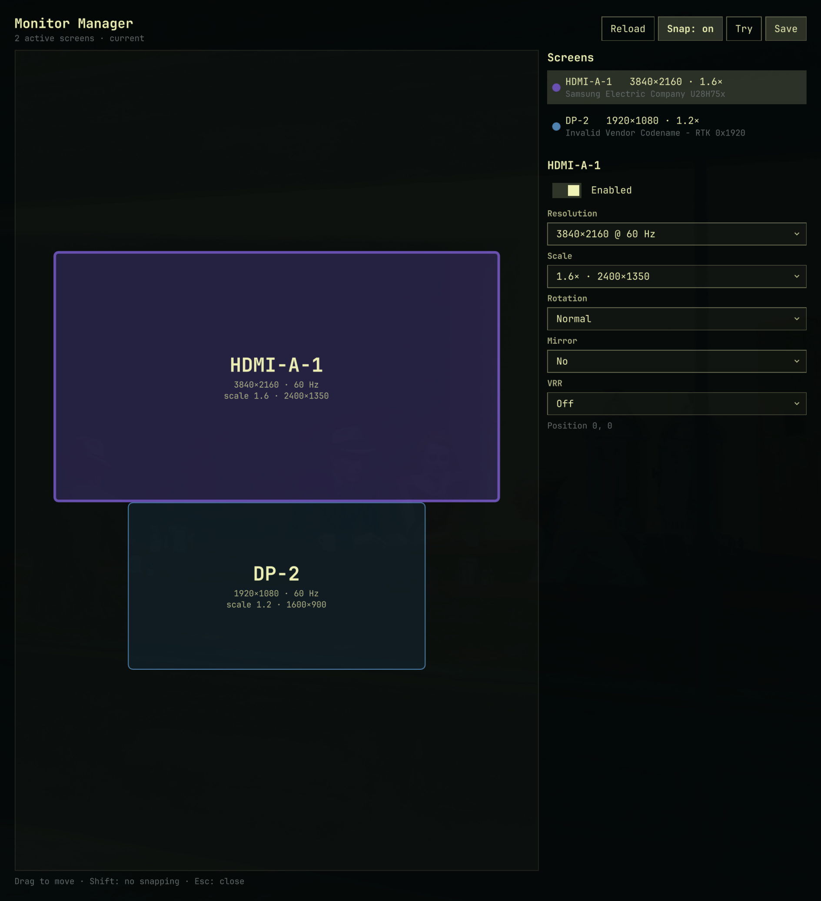

# Omarchy Monitor Arranger

An [Omarchy](https://omarchy.org) shell plugin to arrange your displays
visually: drag monitors into place with snapping, pick resolution, scale,
rotation, VRR and mirroring, try the layout live with an automatic rollback,
then save it to `~/.config/hypr/monitors.lua`.



> **Status: early development (0.1.0).** This plugin grew out of the
> standalone GTK app
> [omarchy_monitor_arranger](https://github.com/FabioCuccaro/omarchy_monitor_arranger),
> which is feature complete and remains available.

## Features

- Drag & drop layout with magnetic snapping to edges, adjacency and centres
  (hold <kbd>Shift</kbd> to disable), guide lines and hysteresis so it doesn't
  jitter at the snap boundary.
- Per monitor: on/off, resolution & refresh rate, scale (only values with an
  integer logical size), rotation/flip, mirroring, VRR.
- Neighbours stay attached when a monitor's size changes.
- Warnings for overlapping or unreachable monitors, with a one-click **Fix**.
- **Try** applies the layout via `hyprctl eval` and rolls back after 15 s
  unless you keep it.
- **Save** rewrites only your outputs' `hl.monitor({...})` blocks (comments,
  variables, the catch-all rule and unmanaged fields such as `bitdepth` are
  kept), backs the file up (last 10 kept), reloads Hyprland and reports
  `hyprctl configerrors`.
- Native look: Omarchy shell fonts, controls and theme colours.

## Requirements

Omarchy with the Quickshell-based shell and Hyprland ≥ 0.55 (Lua config).
No extra packages.

## Install

From git:

```bash
omarchy plugin add https://github.com/FabioCuccaro/omarchy_monitor_manager.git --enable
```

During development, from a checkout of this branch:

```bash
id=io.github.fabiocuccaro.monitor-manager
mkdir -p ~/.config/omarchy/plugins/$id
cp manifest.json Model.js Panel.qml ~/.config/omarchy/plugins/$id/
omarchy-shell shell rescanPlugins
omarchy-shell shell setPluginEnabled $id true
```

## Usage

```bash
omarchy-shell shell toggle io.github.fabiocuccaro.monitor-manager
```

To add it to the Omarchy menu, put an entry in
`~/.config/omarchy/extensions/omarchy-menu.jsonc` whose `action` runs the
command above, or bind it to a key in `~/.config/hypr/bindings.lua`.

## Development

```
manifest.json        plugin manifest (kind: panel)
Panel.qml            UI: window, canvas, sidebar, try/save flow
Model.js             pure layout + monitors.lua logic, no QML types
test/model.test.js   node tests for Model.js
test/fixtures.json   golden results from the reference GTK implementation
```

```bash
node test/model.test.js                                   # logic tests
omarchy plugin validate "$PWD"                            # manifest
qmllint -I "$OMARCHY_PATH/shell" Panel.qml                # QML
```

Saving files under `~/.config/omarchy/plugins/` hot-reloads the plugin.

## Roadmap

- [ ] Identify: show each output's name on its screen
- [ ] Undo and keyboard navigation (arrows to nudge, Tab to cycle)
- [ ] Precise X/Y position fields
- [ ] "Arrange displays…" entry next to the built-in Display panel
- [ ] Publish on [plugins.omarchy.org](https://plugins.omarchy.org)

## License

[MIT](LICENSE) © 2026 Fabio Cuccaro
